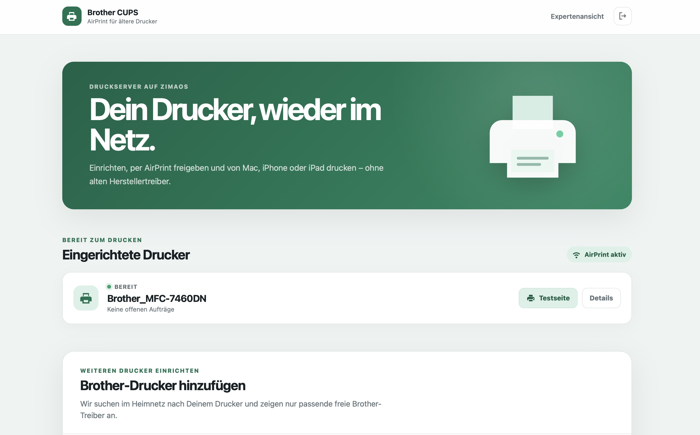
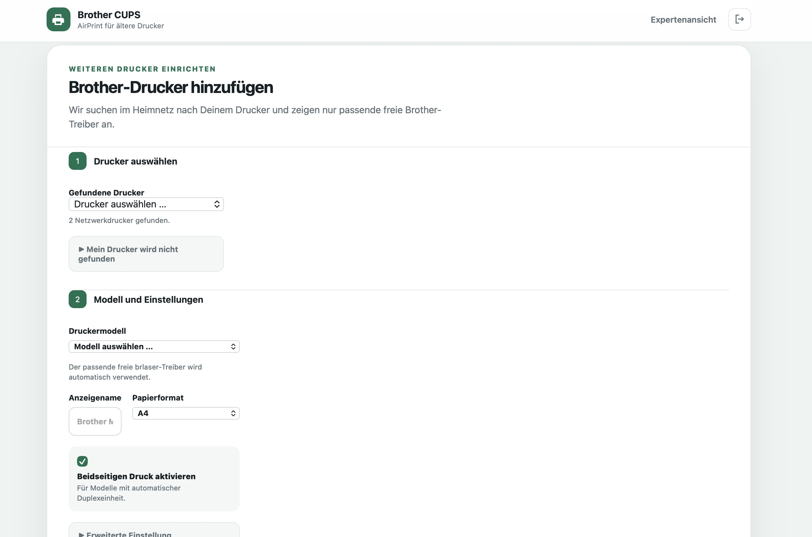
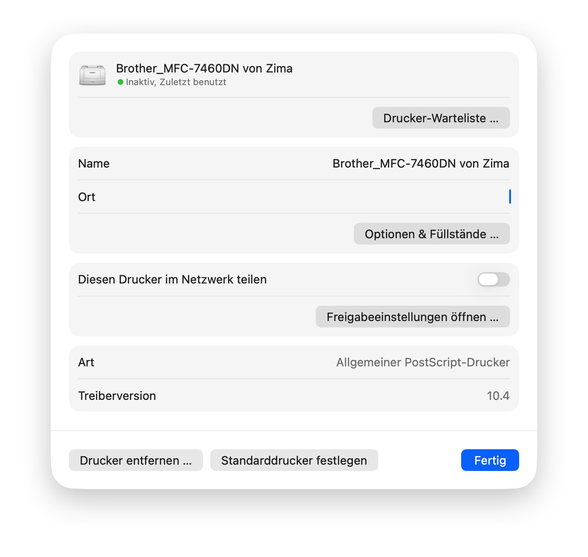

# Brother CUPS: AirPrint for older Brother laser printers

**English** · [Deutsch](README.de.md)

A small CUPS print server in a Docker container, using the free [brlaser](https://github.com/Owl-Maintain/brlaser) driver. It makes older Brother laser printers that have no AirPrint of their own available on your home network as **AirPrint printers**. Macs, iPhones and iPads can then print without any vendor driver and without Rosetta.

## Why?

Many Brother drivers for macOS are Intel-only code and run on Apple silicon Macs only through Rosetta 2. Updating to macOS 27.0 or 27.1 removes Rosetta, and with macOS 28 it goes away for regular apps entirely. A printer like the MFC-7460DN (from around 2011) then stops working on the Mac, even though the hardware is perfectly fine.

This container takes over printing on the network. The Mac no longer cares which driver sits behind it.

Background (German): [macOS 27 and old printers](https://mizine.de/apple/macos-27-drucker-rosetta/) on mizine.de.

## What's inside?

- Base: the official `debian:stable-slim` image
- Debian packages: `cups`, `cups-filters`, `printer-driver-brlaser`, `libnss-mdns`, `ghostscript`, `poppler-utils`
- A simple setup page that finds printers on the network, suggests the matching brlaser model and prints test pages
- A short start script (`entrypoint.sh`) that creates the admin login and can optionally set up the printer automatically

Nothing else. The image is built by GitHub Actions straight from this repo.

Ready-made image for AMD64 and ARM64: `ghcr.io/vdite/brother-cups:latest`

## Screenshots

The setup page is in German for now.



The setup assistant searches your home network for Brother printers and offers the matching free brlaser driver:



After that the printer shows up in macOS like any other AirPrint printer:

| Printer in macOS | Print job |
|---|---|
|  |  |

## Supported printers

Every model that brlaser 6.2.7 (the version in Debian 13 "trixie") supports:

| Series | Models |
|---|---|
| **DCP** | DCP-1510, DCP-1600, DCP-1610W, DCP-7010, DCP-7020, DCP-7030, DCP-7040, DCP-7055, DCP-7055W, DCP-7060D, DCP-7065DN, DCP-7070DW, DCP-7080, DCP-7080D, DCP-8065DN, DCP-B7500D, DCP-L2500D, DCP-L2510D, DCP-L2520D, DCP-L2520DW, DCP-L2537DW, DCP-L2540DW, DCP-L2550DW, DCP-L2560DW |
| **HL** | HL-1110, HL-1200, HL-2030, HL-2130, HL-2140, HL-2220, HL-2230, HL-2240, HL-2240D, HL-2250DN, HL-2260, HL-2260D, HL-2270DW, HL-2280DW, HL-5030, HL-5040, HL-5140, HL-5370DW, HL-5450DN, HL-L2300D, HL-L2305, HL-L2310D, HL-L2320D, HL-L2335D, HL-L2340D, HL-L2350DW, HL-L2360D, HL-L2370DN, HL-L2375DW, HL-L2380DW, HL-L2390DW, HL-L2400DW, HL-L2402D, HL-L2405W, HL-L5000D |
| **MFC** | MFC-1810, MFC-1910W, MFC-7240, MFC-7320, MFC-7340, MFC-7360N, MFC-7365DN, MFC-7420, MFC-7440N, MFC-7460DN, MFC-7860DW, MFC-8440, MFC-8710DW, MFC-8860DN, MFC-9160, MFC-L2690DW, MFC-L2700DN, MFC-L2700DW, MFC-L2710DN, MFC-L2710DW, MFC-L2750DW |
| **FAX** | FAX-2820, FAX-2840 |
| **Other brands** | Fuji Xerox DocuPrint P265 dw, Lenovo LJ2650DN |

Many entries cover a whole series (for example "HL-L2350DW series"). Tested by me: MFC-7460DN. If your model works, feel free to open an issue so it can be marked as tested.

Brother printers that already support AirPrint, like the MFC-9332CDW, don't need this container. Add them directly on the Mac with "AirPrint".

## Requirements

- A Linux machine running Docker that is always on (e.g. ZimaOS, Raspberry Pi, mini PC)
- Avahi on the host (already included in ZimaOS), so the printer is announced via Bonjour
- The printer is connected to the network via LAN and has a fixed IP address (DHCP reservation in your router)
- Ports 631 (AirPrint/CUPS) and 8631 (setup page) are free on the host

## Install on ZimaOS

1. In the App Store, choose **Custom Install** and then **Import**.
2. Paste the contents of [`zimaos-compose.yml`](zimaos-compose.yml).
3. Optionally enter an `ADMIN_PASSWORD`. If you leave it empty, the setup page opens without a login.
4. Install and open the app. ZimaOS takes you straight to the setup page.

## Install with Portainer

1. Open **Stacks** > **Add stack** > **Web editor**.
2. Paste the contents of [`portainer-compose.yml`](portainer-compose.yml).
3. Under **Environment variables**, optionally add `ADMIN_PASSWORD` with the password you want. Without it, the setup page runs without a login.
4. Click **Deploy the stack** and then open `http://<server-ip>:8631`.

Portainer pulls the ready-made image from the GitHub Container Registry. No local build needed.

## Install with Docker Compose

```
git clone https://github.com/vdite/brother-cups.git
cd brother-cups
docker compose up -d --build
```

This variant builds the image locally on purpose. To just run the ready-made image from GitHub, use `portainer-compose.yml` or `zimaos-compose.yml` instead.

Then open `http://<server-ip>:8631`.

## Set up the printer

1. Open the setup page at `http://<server-ip>:8631`. If `ADMIN_PASSWORD` is set, log in with `admin` and that password.
2. Wait a moment until the printer search has finished, then select your Brother printer.
3. Choose the matching model. If the model name is unambiguous, it is already preselected.
4. Check paper size and duplex, then click **Drucker einrichten** (set up printer).
5. Use **Testseite** (test page) to check right away that everything works.

If the printer isn't found automatically, you can enter its fixed IP address. The setup page then uses `socket://<ip>:9100`.

The regular CUPS web interface stays available at `http://<server-ip>:631` for technical details and rare special cases. You don't need it for the setup.

<details>
<summary>Set up the printer in the CUPS web interface instead</summary>

1. Open `http://<server-ip>:631` in your browser.
2. **Administration** > **Add Printer**, log in with `admin` and the `ADMIN_PASSWORD` you set.
3. Pick the printer from the list of discovered network printers, or choose **AppSocket/HP JetDirect** with `socket://<printer-ip>:9100`.
4. "Share This Printer" is already checked, leave it that way.
5. Choose manufacturer **Brother**, then your model with **"using brlaser"**.
6. Under **Set Default Options**, set the paper size and print a test page.

Multiple printers are no problem, just add them one after another.

Without `ADMIN_PASSWORD` the simple setup page is fully usable, but administrative changes directly in CUPS require a password to be set.

</details>

## Or: create the printer automatically

If you prefer to keep everything in the compose file, set `PRINTER_URI` and `PRINTER_MODEL`. The container then creates the printer on every start.

| Variable | Example | Meaning |
|---|---|---|
| `ADMIN_USER` | `admin` | User name for the web interfaces |
| `ADMIN_PASSWORD` | | Optional password, empty = setup page without login |
| `BROTHER_CUPS_UI_PORT` | `8631` | Port of the simple setup page |
| `PRINTER_URI` | `socket://192.168.1.50:9100` | Printer address (port 9100 = RAW/JetDirect) |
| `PRINTER_MODEL` | `MFC-7460DN` | Model from the brlaser list, or the full `drv:///…` path |
| `PRINTER_NAME` | `Brother` | Name of the print queue (no spaces) |
| `PAPER_SIZE` | `A4` | Default paper size |
| `PRINTER_OPTIONS` | `-o Duplex=DuplexNoTumble` | Additional options for `lpadmin` (optional) |

To see which models brlaser supports in your container:

```
docker exec brother-cups lpinfo -m | grep brlaser
```

If the start script can't find your model, it writes the list to the container log.

## Add the printer on Mac, iPhone and iPad

**Mac:** System Settings > Printers & Scanners > Add Printer. The printer shows up with the server's name. Under "Use", choose **AirPrint**.

**iPhone and iPad:** Share > Print. The printer appears automatically.

## Limitations

- **Scanning and fax:** The container only handles printing.
- **Printers brlaser doesn't know:** see [Supported printers](#supported-printers).
- CUPS warns during setup that printer drivers are "deprecated". They keep working with CUPS 2.x.

## Security

- Printing and viewing the CUPS web interface is allowed for every device on the network.
- If `ADMIN_PASSWORD` is set, it protects the simple setup page and administrative changes in CUPS.
- Without `ADMIN_PASSWORD` the simple setup page is reachable by every device on your home network. CSRF protection and sessions stay active, but they don't replace a login. On networks with untrusted devices, set a password.
- Both web interfaces use plain HTTP. A password therefore travels unencrypted through your LAN. That's common for a private network, not for a company network.
- Don't expose the container to the internet.

## License

The project's own code and the files in this repo are licensed under the [MIT License](LICENSE).

The built image as a whole is not exclusively MIT-licensed. It contains unmodified Debian packages with their own licenses, including CUPS, cups-filters, brlaser, Ghostscript and Poppler. Details, source links and where to find them in the image are in [THIRD_PARTY_LICENSES.md](THIRD_PARTY_LICENSES.md). GitHub Actions also publishes an SBOM and build provenance.

Brother is a trademark of Brother Industries, Ltd. This project is not affiliated with Brother.
