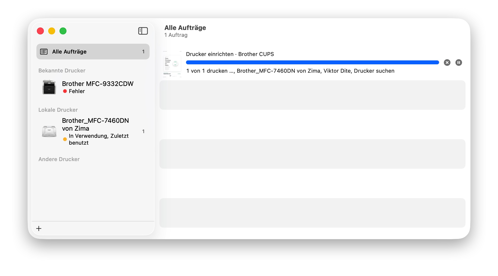

# Brother CUPS: AirPrint für ältere Brother-Laserdrucker

Ein kleiner CUPS-Druckserver im Docker-Container, mit dem freien Treiber [brlaser](https://github.com/Owl-Maintain/brlaser). Er macht ältere Brother-Laserdrucker, die selbst kein AirPrint können, im Heimnetz als **AirPrint-Drucker** verfügbar. Mac, iPhone und iPad drucken dann ohne Herstellertreiber und ohne Rosetta.

## Warum?

Viele Brother-Treiber für macOS sind reiner Intel-Code und laufen auf Macs mit Apple-Chip nur über Rosetta 2. macOS 27 entfernt Rosetta beim Update, mit macOS 28 fällt es für normale Programme ganz weg. Ein Drucker wie der MFC-7460DN (Baujahr um 2011) funktioniert dann am Mac nicht mehr, obwohl er technisch einwandfrei ist.

Dieser Container übernimmt das Drucken im Netz. Dem Mac ist es dann egal, welcher Treiber dahintersteckt.

Hintergrund: [macOS 27 und alte Drucker](https://mizine.de/apple/macos-27-drucker-rosetta/) auf mizine.de.

## Was ist drin?

- Basis: offizielles Image `debian:stable-slim`
- Pakete aus Debian: `cups`, `cups-filters`, `printer-driver-brlaser`, `libnss-mdns`, `ghostscript`, `poppler-utils`
- Eine einfache Einrichtungsoberfläche, die Drucker im Netz findet, passende brlaser-Modelle anbietet und Testseiten druckt
- Ein kurzes Startskript (`entrypoint.sh`), das den Admin-Zugang anlegt und auf Wunsch auch den Drucker automatisch einrichtet

Sonst nichts. Das Image wird per GitHub Actions direkt aus diesem Repo gebaut.

Fertiges Image für AMD64 und ARM64: `ghcr.io/vdite/brother-cups:latest`

## So sieht es aus


Die übersichtliche Einrichtung sucht selbstständig nach Brother-Druckern im Heimnetz und bietet die passenden freien brlaser-Treiber an:


Danach erscheint der Drucker ganz normal in macOS und nimmt Druckaufträge per AirPrint an:

| Drucker in macOS | Erfolgreicher Druckauftrag |
|---|---|
|  |  |

## Voraussetzungen

- Ein Linux-Rechner mit Docker, der dauerhaft läuft (z. B. ZimaOS, Raspberry Pi, Mini-PC)
- Avahi auf dem Host (bei ZimaOS schon vorhanden), damit der Drucker per Bonjour auftaucht
- Der Drucker hängt per LAN im Netz und hat eine feste IP (Adressreservierung im Router)
- Die Ports 631 (AirPrint/CUPS) und 8631 (einfache Einrichtung) sind auf dem Host frei

## Installation unter ZimaOS

1. Im App Store auf **Benutzerdefiniert installieren** und dann **Importieren** gehen.
2. Den Inhalt von [`zimaos-compose.yml`](zimaos-compose.yml) einfügen.
3. Optional ein `ADMIN_PASSWORD` eintragen. Bleibt es leer, öffnet sich die Einrichtungsoberfläche ohne Login.
4. Installieren und anschließend die App öffnen. ZimaOS führt direkt zur einfachen Einrichtungsseite.

## Installation in Portainer

1. **Stacks** > **Add stack** > **Web editor** öffnen.
2. Den Inhalt von [`portainer-compose.yml`](portainer-compose.yml) einfügen.
3. Unter **Environment variables** optional `ADMIN_PASSWORD` mit dem gewünschten Passwort anlegen. Ohne diese Variable läuft die einfache Oberfläche ohne Login.
4. **Deploy the stack** anklicken und danach `http://<IP-des-Servers>:8631` öffnen.

Portainer lädt das fertige Image aus der GitHub Container Registry. Ein lokaler Build ist dafür nicht erforderlich.

## Installation mit Docker Compose

```
git clone https://github.com/vdite/brother-cups.git
cd brother-cups
docker compose up -d --build
```

Diese Variante baut das Image bewusst lokal. Wer nur das fertige GitHub-Image starten möchte, verwendet stattdessen `portainer-compose.yml` oder `zimaos-compose.yml`.

Danach `http://<IP-des-Servers>:8631` öffnen.

## Drucker einrichten

1. Die Einrichtungsseite unter `http://<IP-des-Servers>:8631` öffnen. Wenn `ADMIN_PASSWORD` gesetzt ist, mit `admin` und diesem Passwort anmelden.
2. Kurz warten, bis die Druckersuche abgeschlossen ist, dann den Brother-Drucker auswählen.
3. Das passende Modell wählen. Bei eindeutigem Modellnamen wird es bereits vorausgewählt.
4. Papierformat und Duplex prüfen und **Drucker einrichten** anklicken.
5. Über **Testseite** direkt kontrollieren, ob alles funktioniert.

Wird der Drucker nicht automatisch gefunden, lässt sich seine feste IP-Adresse eintragen. Die Oberfläche verwendet dann `socket://<IP>:9100`.

Die bisherige CUPS-Oberfläche bleibt für technische Details und seltene Spezialfälle unter `http://<IP-des-Servers>:631` erreichbar. Normale Nutzer brauchen sie für die Einrichtung nicht mehr.

<details>
<summary>Drucker direkt in der CUPS-Expertenansicht einrichten</summary>

1. `http://<IP-des-Servers>:631` im Browser öffnen.
2. **Verwaltung** > **Drucker hinzufügen**, mit `admin` und dem gesetzten `ADMIN_PASSWORD` anmelden.
3. Den Drucker aus der Liste der gefundenen Netzwerkdrucker wählen, oder **AppSocket/HP JetDirect** mit `socket://<IP-des-Druckers>:9100`.
4. „Drucker im Netzwerk freigeben“ ist schon angehakt, so lassen.
5. Hersteller **Brother**, dann Dein Modell mit **„using brlaser“** wählen.
6. Unter **Standardeinstellungen** das Papierformat auf A4 setzen und eine Testseite drucken.

Mehrere Drucker sind kein Problem, einfach nacheinander hinzufügen.

Ohne `ADMIN_PASSWORD` ist die einfache Oberfläche vollständig nutzbar; administrative Änderungen direkt in CUPS erfordern dagegen ein gesetztes Passwort.

</details>

## Oder: Drucker automatisch anlegen

Wer lieber alles in der Compose-Datei hat, setzt `PRINTER_URI` und `PRINTER_MODEL`. Dann legt der Container den Drucker bei jedem Start selbst an.

| Variable | Beispiel | Bedeutung |
|---|---|---|
| `ADMIN_USER` | `admin` | Benutzername für die Weboberfläche |
| `ADMIN_PASSWORD` | | Optionales Passwort, leer = Einrichtungsoberfläche ohne Login |
| `BROTHER_CUPS_UI_PORT` | `8631` | Port der einfachen Einrichtungsoberfläche |
| `PRINTER_URI` | `socket://192.168.1.50:9100` | Adresse des Druckers (Port 9100 = RAW/JetDirect) |
| `PRINTER_MODEL` | `MFC-7460DN` | Modell laut brlaser-Liste, alternativ der volle `drv:///…`-Pfad |
| `PRINTER_NAME` | `Brother` | Name der Druckwarteschlange (ohne Leerzeichen) |
| `PAPER_SIZE` | `A4` | Standard-Papierformat |
| `PRINTER_OPTIONS` | `-o Duplex=DuplexNoTumble` | Weitere Optionen für `lpadmin` (optional) |

Welche Modelle brlaser unterstützt:

```
docker exec brother-cups lpinfo -m | grep brlaser
```

Findet das Startskript Dein Modell nicht, schreibt es die Liste ins Container-Log.

## Am Mac, iPhone und iPad hinzufügen

**Mac:** Systemeinstellungen > Drucker & Scanner > Drucker hinzufügen. Der Drucker taucht mit dem Namen des Servers auf. Bei „Verwenden“ **AirPrint** wählen.

**iPhone und iPad:** Teilen > Drucken. Der Drucker erscheint automatisch.

## Was nicht geht

- **Scannen und Fax:** Der Container kümmert sich nur ums Drucken.
- **Drucker, die brlaser nicht kennt:** Die Liste der unterstützten Modelle steht im [brlaser-Repo](https://github.com/Owl-Maintain/brlaser).
- CUPS meldet beim Einrichten, dass Druckertreiber „deprecated“ sind. Mit CUPS 2.x funktionieren sie weiterhin.

## Sicherheit

- Drucken und Ansehen der CUPS-Expertenansicht ist für alle Geräte im Netz erlaubt.
- Wenn `ADMIN_PASSWORD` gesetzt ist, schützt es die einfache Einrichtungsoberfläche und administrative Änderungen in CUPS.
- Ohne `ADMIN_PASSWORD` ist die einfache Oberfläche für alle Geräte im Heimnetz erreichbar. CSRF-Schutz und Sitzungen bleiben aktiv, ersetzen aber keine Anmeldung. In Netzen mit nicht vertrauenswürdigen Teilnehmern sollte deshalb ein Passwort gesetzt werden.
- Beide Oberflächen laufen im Heimnetz über HTTP. Ein gesetztes Passwort geht daher unverschlüsselt durchs LAN. Für ein privates Netz ist das üblich, für Firmennetze nicht.
- Den Container nicht ins Internet freigeben.

## Lizenz

Der selbst entwickelte Projektcode und die Repo-Dateien stehen unter der [MIT-Lizenz](LICENSE).

Das gebaute Image als Ganzes ist nicht ausschließlich MIT-lizenziert. Es enthält unveränderte Debian-Pakete mit eigenen Lizenzen, unter anderem CUPS, cups-filters, brlaser, Ghostscript und Poppler. Die Details, Quellcode-Links und Fundstellen im Image stehen in [THIRD_PARTY_LICENSES.md](THIRD_PARTY_LICENSES.md). GitHub Actions veröffentlicht zusätzlich SBOM und Build-Provenance.

Brother ist eine Marke der Brother Industries, Ltd. Dieses Projekt steht in keiner Verbindung zu Brother.
